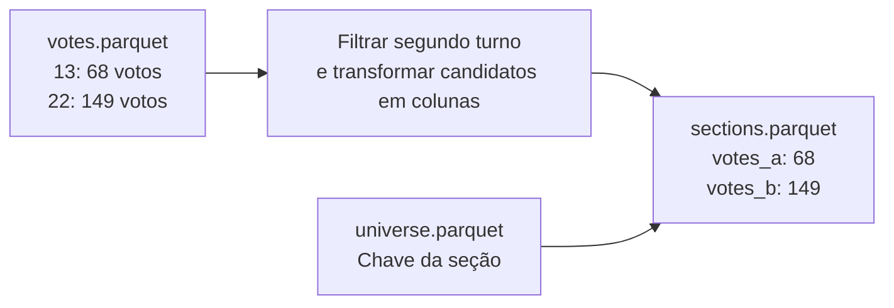
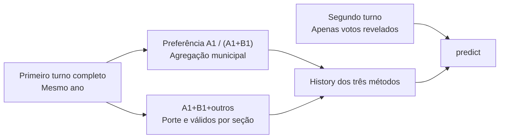

# Dicionário dos dados

[← Especificação visual](especificacao.md) · [Comandos de execução](../README.md)

Este documento descreve os arquivos produzidos pelo projeto. Os tipos foram conferidos nos Parquets gerados; `string` corresponde ao tipo Arrow `large_string`, `float64` a `double` e os inteiros a `int64`.

## 1. Organização e chaves

```text
/mnt/ssd1tb/inf425-tse/             # No host; /data/tse no container
├── raw/<ano>/
│   ├── votes/                    # ZIP presidencial por seção
│   ├── summary/                  # Resumo independente para conferir totais
│   ├── totals/                   # Histórico oficial de totalização
│   └── bu/                       # Boletins de segundo turno
├── processed/<ano>/              # Parquets e auditorias daquele ano
├── manifests/                    # Catálogos, URLs, hashes e inventários
└── runtime/python/               # Dependências adicionais do container
```

| Objeto | Chave |
|---|---|
| Município | `uf + municipality` |
| Seção em uma eleição | `uf + municipality + zone + section` |
| Votação de um candidato | `year + turn + chave da seção + candidate` |
| Projeção em uma execução | `method + fraction_sections` |

O ano está nas linhas de `votes.parquet`. Nos outros Parquets de entrada, está no diretório. Portanto, se juntar vários anos em uma só tabela, adicione a coluna `year` antes de concatenar.

**Identificadores não são quantidades.** Preserve zeros à esquerda. `municipality` é código eleitoral TSE, não código IBGE. Zona e seção, isoladamente, não identificam uma seção no país.

## 2. Votação normalizada: `votes.parquet`

**Granularidade:** uma linha por candidato, seção, turno e ano, para Presidente. Guarda votos válidos dos dois turnos; brancos e nulos permanecem apenas nos ZIPs de origem.

| Campo | Tipo | Significado | Exemplo |
|---|---|---|---|
| `year` | int64 | Ano da eleição. | `2026` |
| `turn` | int64 | Turno: 1 ou 2. | `2` |
| `uf` | string | UF ou código especial. | `AC`, `ZZ`, `VT` |
| `municipality` | string | Código eleitoral do município, cinco dígitos. | `01007` |
| `zone` | string | Zona eleitoral, quatro dígitos. | `0009` |
| `section` | string | Seção eleitoral, quatro dígitos. | `0001` |
| `local` | string | Código de local de votação, quando disponível. | `1104` |
| `candidate` | string | Número do candidato votável. | `13` |
| `candidate_name` | string | Nome fornecido pela fonte. | `LUIZ INÁCIO LULA DA SILVA` |
| `votes` | int64 | Contagem não negativa de votos daquela linha. | `68` |

Em leiautes sem `local`, o código grava string vazia. Sem nome do votável, usa o próprio número como identificação textual. O filtro atual considera o cargo presidencial (`CD_CARGO = 1`) e números votáveis de 1 a 94; os códigos especiais de votos inválidos ficam fora do Parquet de válidos.

A preparação valida duplicatas de seção/candidato do **segundo turno**. Não há restrição de chave declarada pelo próprio formato Parquet.

## 3. Universo e resultado por seção

### `universe.parquet`

**Granularidade:** uma linha por seção do segundo turno presente na fonte. Contém apenas quatro colunas `string`: `uf`, `municipality`, `zone`, `section`.

Ele representa a estrutura do universo, sem informar os votos. Inclui seções que só apresentem registros brancos/nulos. Não garante incluir seções inteiramente ausentes da publicação do TSE.

### `sections.parquet`

**Granularidade:** uma linha por seção do mesmo universo, com o resultado dos dois finalistas no segundo turno. Esta tabela é o alvo do avaliador e não é carregada como referência.

| Campo | Tipo | Significado |
|---|---|---|
| `uf` | string | Parte da chave da seção. |
| `municipality` | string | Parte da chave da seção. |
| `zone` | string | Parte da chave da seção. |
| `section` | string | Parte da chave da seção. |
| `votes_a` | int64 | Votos válidos de A naquela seção. |
| `votes_b` | int64 | Votos válidos de B naquela seção. |

A corresponde ao finalista do PT e B ao outro finalista, conforme [`elections.json`](../configs/elections.json). Ausência de registro de um dos candidatos em uma seção recebe zero na transformação para o formato de duas colunas. O resultado completo desta tabela fica sob controle do avaliador; o estimador recebe apenas a parte revelada.



Exemplo real da tabela de 2026:

| uf | municipality | zone | section | votes_a | votes_b |
|---|---|---|---|---:|---:|
| AC | 01007 | 0009 | 0001 | 68 | 149 |

### `first_turn_sections.parquet` e `first_turn_reference.json`

Referência exclusiva dos modelos: **primeiro turno do mesmo ano**. Uma linha por seção do universo próprio do primeiro turno, inclusive seções com zero válidos. O arquivo é extraído diretamente do ZIP oficial; não substitui `sections.parquet`, que permanece como alvo do segundo turno.

| Campo | Tipo | Significado |
|---|---|---|
| `uf`, `municipality`, `zone`, `section` | string | Chave da seção no primeiro turno. |
| `votes_a`, `votes_b` | int64 | Votos dos dois finalistas do segundo turno no primeiro turno. |
| `votes_other` | int64 | Votos dos candidatos eliminados. |
| `valid_votes` | int64 | Todos os válidos: A + B + outros; exclui brancos/nulos. |

A preferência municipal é `sum(votes_a) / sum(votes_a + votes_b)`. O porte é `sum(valid_votes)` e a média por seção é `sum(valid_votes) / número de seções do primeiro turno`. Portanto, os votos dos eliminados entram no volume, sem serem atribuídos automaticamente a um finalista. Sem votos dos finalistas no município, a preferência usa fallback da UF/nacional; o volume local conhecido é preservado.

O manifesto registra `year`, `turn: 1`, finalistas, contagens, `source_file`, SHA-256 do ZIP e `reference_sha256` do Parquet. O carregador verifica ambos os hashes e exige ano/finalistas/turno corretos. O replay agrega a referência por município e não pressupõe correspondência de seções entre os turnos. Em 2018 há 454.450 seções no primeiro turno e 454.448 no segundo; cada denominador vem de seu próprio universo.



## 4. Ordem de recebimento: `order.parquet`

**Granularidade esperada:** uma linha por seção e horário do relógio auditado. Em 2022/2026 é recebimento do BU; em 2018 é primeira totalização parcial. O arquivo pode ser escrito mesmo se a auditoria o reprovar; a existência do arquivo, isoladamente, não autoriza uso histórico.

| Campo | Tipo | Significado |
|---|---|---|
| `uf`, `municipality`, `zone`, `section` | string | Chave de correspondência com o universo. |
| `timestamp` | timestamp[ns] | Horário conforme `chronology.json`: recebimento ou primeira totalização parcial, sem fuso associado. |

A extração reconhece `DT_BU_RECEBIDO` ou `DT_RECEBIMENTO_BU`, com horário separado quando fornecido. Datas brasileiras e ISO são interpretadas separadamente. Registros idênticos repetidos entre candidatos são deduplicados. Horários conflitantes para a mesma seção invalidam a ordem.

O arquivo não precisa estar fisicamente ordenado. O replay ordena por `timestamp` e chave da seção. Seções com mesmo timestamp são reveladas juntas.

**Para usar:** confira `chronology.json`, incluindo `usable`, cobertura e `order_sha256`. O replay verifica o hash e as referências aos manifestos de origem. Timestamp de emissão ou encerramento da urna não substitui timestamp de recebimento.

## 5. Resultados: `projections.parquet`

**Local:** `reports/<execucao>/projections.parquet`.  
**Granularidade:** uma linha por método e snapshot efetivo da execução.

| Campo | Tipo | Significado e unidade |
|---|---|---|
| `share_a` | float64 | Proporção nacional projetada para A, de 0 a 1. |
| `share_b` | float64 | Proporção projetada para B; complemento de A. |
| `votes_a` | float64 | Total projetado de votos de A, incluindo observados e estimados. |
| `votes_b` | float64 | Total projetado de votos de B, incluindo observados e estimados. |
| `fraction_sections` | float64 | Fração efetiva de seções reveladas no universo do dataset. |
| `observed_valid` | float64 | Quantidade de válidos observados, representada como real. |
| `turnout_ratio` | float64 | Ajuste nacional suavizado de comparecimento; 1 = volume histórico por seção mantido. |
| `method` | string | `poststrat`, `swing` ou `hierarchical`. |
| `requested_fraction` | float64 | Marco pedido; pode ser menor que a fração efetiva por causa dos empates. |
| `observed_sections` | int64 | Número efetivo de seções reveladas. |
| `baseline_share_a` | float64, anulável | Parcial simples de A nos válidos observados. Nulo se ainda não há válidos. |
| `baseline_error_pp` | float64, anulável | Erro absoluto da parcial simples, em pontos percentuais. |
| `final_share_a` | float64 | Proporção final de A, usada apenas pelo avaliador. |
| `error_pp` | float64 | Erro absoluto da projeção de A, em pontos percentuais. |
| `elapsed_seconds` | float64 | Tempo da chamada a `predict`, incluindo sua preparação interna; exclui construção do snapshot e leitura do dataset. |
| `year` | int64 | Eleição avaliada. |
| `reference_year` | int64 | Mesmo ano da eleição avaliada. |
| `turn` | int64 | Turno avaliado: sempre 2. |
| `reference_turn` | int64 | Turno de referência: sempre 1. |
| `mode` | string | `historical` ou `simulated`. |

**Atenção ao nome `votes_a`:** em `sections.parquet` ele é uma contagem inteira de uma seção; em `projections.parquet` é uma estimativa real para o país inteiro. Use nomes distintos ao unir tabelas.

Os arquivos CSV de projeções contêm as mesmas colunas. `elapsed_seconds` é uma medição operacional; não constitui, sozinho, um benchmark controlado entre CPU e GPU.

## 6. Objetos em memória

Estes objetos não são arquivos Parquet. A interface é `predict(snapshot, history, config) -> Projection`.

### `Snapshot.frame`

Uma linha por município observado. Contém `uf`, `municipality`, `n_observed`, `votes_a`, `votes_b`. As contagens são somas das seções já reveladas. Municípios ainda não observados podem estar ausentes; o estimador os completa com zero observações.

### `History.frame`

Uma linha por município do universo atual:

| Campo | Tipo lógico | Origem |
|---|---|---|
| `uf`, `municipality` | string | Identificadores atuais. |
| `region` | string | `N`, `NE`, `CO`, `SE`, `S`, `EX` ou `TRANSIT`. |
| `n_sections` | inteiro | Contagem estrutural atual, sem votos. |
| `ref_share` | real | A1/(A1+B1) do primeiro turno do mesmo ano, ou fallback. |
| `ref_per_section` | real | Todos os válidos do primeiro turno / seções do próprio primeiro turno, ou fallback. |
| `ref_size` | número | Total de válidos do primeiro turno, incluindo eliminados; no fallback, total do grupo. |
| `matched` | booleano | Se o município tem votos dos finalistas no primeiro turno, permitindo calcular a preferência local. |

Uma correspondência por código é a regra atual. Mudanças territoriais que mantenham códigos não são corrigidas por uma harmonização geográfica adicional.

### `Config`

| Campo | Padrão | Efeito |
|---|---|---|
| `method` | `poststrat` | Escolha do estimador. |
| `device` | `cpu` na API | `cpu` ou `cuda`; a CLI usa `cuda` por padrão. |
| `lambda_region` | `300000.0` | Penalização região → nacional. |
| `lambda_uf` | `150000.0` | Penalização UF → região. |
| `lambda_turnout` | `200000.0` | Suavização do comparecimento. |

Os lambdas podem ser alterados pela API Python. A CLI atual não expõe argumentos para mudá-los. `Projection` retorna os oito primeiros campos do dicionário de resultados: de `share_a` até `method`.

## 7. Manifestos e arquivos JSON

| Arquivo | Pergunta que responde | Campos principais |
|---|---|---|
| `manifests/catalog-*.json` | O que o catálogo do TSE publicou? | Resposta CKAN com recursos e URLs. |
| Manifesto de cada download | De onde veio este ZIP e ele terminou de baixar? | `url`, `resource_id`, `status`, `bytes`, `sha256`, `retrieved_at`. |
| `preparation.json` | O que foi normalizado neste ano? | Hash da origem, candidatos, totais, seções e tamanhos. |
| `totals-check.json` | Os totais batem com outra publicação oficial? | `official_totals`, `section_totals`, `difference`, `status`. |
| `chronology.json` | A ordem pode ser usada como histórica? | `usable`, cobertura, timestamps, conflitos, hashes e `source_manifests`. |
| `run.json` | Como esta execução foi produzida? | Configuração `study`, anos, dispositivo, versões, hashes dos dados e fontes, proveniência da ordem. |
| `convergence.json` | Em qual snapshot a estimativa entrou e permaneceu na faixa? | `milestones`, `sampled_grid_only`, limites por método. |

Os valores de convergência são **frações**, não percentuais inteiros. `null` significa que nenhum snapshot satisfaz o critério até o fim da grade executada.

## 8. Abrir os dados em Python

Execute no container do projeto, onde `/data/tse` aponta para o SSD:

```python
from pathlib import Path
import pandas as pd

root = Path('/data/tse/processed/2026')

# Votos dos finalistas por seção do segundo turno.
sections = pd.read_parquet(root / 'sections.parquet')

# Apenas segundo turno, com filtro na leitura do Parquet longo.
votes = pd.read_parquet(
    root / 'votes.parquet',
    filters=[('turn', '==', 2)],
    columns=['uf', 'municipality', 'zone', 'section', 'candidate', 'votes'],
)

# Conferir totais por UF.
print(sections.groupby('uf')[['votes_a', 'votes_b']].sum())

# Consultar uma execução já produzida.
projections = pd.read_parquet('/workspace/reports/historical-2026/projections.parquet')
print(projections[['method', 'fraction_sections', 'share_a', 'error_pp']])
```

Para unir ordem e votos, use as quatro colunas da chave e valide a cardinalidade:

```python
order = pd.read_parquet(root / 'order.parquet')
ordered = sections.merge(
    order,
    on=['uf', 'municipality', 'zone', 'section'],
    validate='one_to_one',
).sort_values('timestamp')
```

Essa união é útil para inspeção. Para executar experimentos, use o replay do projeto, que também verifica auditoria, hashes e empates.


## 9. Curvas oficiais: `curves.parquet`

**Local:** `reports/apuracao/curves.parquet`.  
**Granularidade:** uma linha por eleição e horário distinto da série. O exportador vigente contém somente reconstrução por primeira totalização em 2018 e históricos oficiais de 2022/2026, conforme `configs/study.json`. Não contém projeções nem sequências simuladas. A extração do PDF de 2014 permanece separada em `processed/2014/national_totalization.parquet`, no acervo.

| Campo | Tipo | Significado |
|---|---|---|
| `year` | int64 | Ano da eleição. |
| `timestamp` | timestamp[ns] | Horário da totalização ou primeira totalização, conforme `kind`, sem atribuição de fuso. |
| `sections` | int64 | Número acumulado de seções. |
| `sections_total` | int64 | Denominador oficial em 2022/2026, universo reconstruído em 2018. |
| `votes_a` | int64 | Votos válidos acumulados de A. |
| `votes_b` | int64 | Votos válidos acumulados de B. |
| `fraction_sections` | float64 | `sections / sections_total`. |
| `share_a` | float64 | `votes_a / (votes_a + votes_b)`. |
| `share_b` | float64 | Complemento da proporção de A. |
| `kind` | string | `reconstructed_first_totalization` ou `official_totalization`. |

Para 2022, o adaptador lê as contagens nacionais acumuladas. Para 2026, soma os incrementos por horário, contando seções **uma única vez por evento** identificado por UF, município, zona e ID da totalização. Brancos/nulos não entram na soma dos finalistas. A série de cada eleição precisa terminar nos votos finais já auditados para ser exportada.

O denominador oficial de seções não é substituído pelo universo de `sections.parquet`. Por exemplo, o histórico de 2026 termina em 499.205 de 499.248 seções, mantendo a fração aproximada de 0,99991387.

`curves.json` contém `study` e os mesmos pontos em formato compacto para a página: cada elemento de `points` é `[segundos_desde_o_primeiro_registro, secoes_acumuladas, votos_a, votos_b]`. `start` guarda a data/hora inicial sem fuso; `sections_total`, nomes e URLs ficam nos metadados da eleição. A seleção vigente inclui somente 2018, 2022 e 2026.

`manifest.json` registra hashes do HTML e do Parquet, dos fontes do exportador e da fonte oficial de cada série. O HTML incorpora os dados necessários; não depende desses arquivos auxiliares para abrir em outro computador.


## 10. Horários por seção e parciais documentais

### `processed/2018/section_timing.parquet`

Uma linha para cada seção do universo de votação: `uf`, `municipality`, `zone`, `section` (strings), `received_at` e `first_totalized_at` (`timestamp[ns]`). Os horários são os dos campos oficiais `DT_RECEBIMENTO_BU_HOR_TSE` e `DT_PRIM_TOT_PARCIAL_HOR_TSE`.

`order.parquet` de 2018 corresponde a `first_totalized_at` renomeado como `timestamp`. A auditoria verifica correspondência e votos nominais, mantém datas tardias e vincula os hashes de horários, universo e votos por seção. Ela identifica a reconstrução com resultados finais; não recupera versões intermediárias dos votos.

### `processed/2014/national_totalization.parquet`

A tabela extraída do PDF nacional usa os campos de `curves.parquet`, antes de adicionar `kind`; seu `timestamp` é armazenado como `timestamp[us]`, promovido a `timestamp[ns]` na união com as outras séries. Não há contagens de seções: os três campos de avanço por seção permanecem nulos. Os percentuais são calculados dos votos e conferidos contra os percentuais arredondados do PDF.

### `processed/2010/documented_partials.parquet`

Cinco observações documentais nacionais, com fonte e precisão preservadas. `publication_timestamp` registra o horário da notícia. `totalization_timestamp` permanece desconhecido. `votes_a` e `votes_b` são inteiros anuláveis: os valores arredondados em milhões não são convertidos em contagens exatas. `urns_percent_reported` é o percentual de urnas publicado, sem conversão para contagem de seções. `percent_a_reported`, `percent_b_reported`, `vote_count_precision`, `source_url` e os textos publicados documentam cada observação.

Esse arquivo não alimenta o replay histórico e não é interpolado em uma curva completa. Consulte a [pesquisa de fontes](pesquisa-cronologia.md) para os registros e suas limitações.

## 11. Escopo do estudo e exemplos didáticos

`configs/study.json` define `evaluation_years` (2018/2022/2026), `reference_policy` (`same_year_first_round`), `reference_turn` (1), `turn` (2), `progress_unit` (`sections_in_dataset`), `smoke_milestones` (frações), `convergence_thresholds_pp` (pontos percentuais) e `recommended_experiment_grid_step` (0,01). Novas execuções copiam essa configuração em `run.json`; diretórios antigos conservam seus metadados originais.

`reports/metodos/examples.json` contém `synthetic: true`, `study`, `lambda_options` e os estados fictícios dos três exemplos. As chaves são `nx:ny` em `poststrat` (231 estados), deslocamento inteiro em p.p. em `swing` (21 estados), e `n_sp:lambda_uf` em `hierarchical` (606 estados). Cada estado inclui projeção, parcial simples, válidos observados/pendentes e decomposição dos votos de A; a hierarquia inclui os swings de cada nível e o peso local do caso escalar.

As funções em `projecao.didactic` chamam o estimador real e verificam as contas simplificadas. O HTML incorpora esses dados, sem depender de leitura externa. `reports/metodos/manifest.json` registra hashes do HTML, exemplos e fontes, versão Torch e configuração do estudo. Esses exemplos não entram nos Parquets de experimentos ou nas métricas de convergência.

## 12. Painel dos experimentos: `reports/convergencia/`

O HTML independente [`convergencia.html`](../reports/convergencia.html) usa os resultados reais dos três métodos nos três pleitos. A fonte padrão é `reports/cpu-study-20261107/grid-<ano>/{projections.parquet,run.json}`. O exportador valida ano/turnos, cronologia, proporções, erros, endpoint de 100% e igualdade dos snapshots entre os métodos. Ele não executa estimadores.

`series.json` contém a configuração `study`, nomes dos métodos e `elections`, indexado por ano. Cada eleição traz finalistas, resultado final, relógio e `points`: fração efetiva, marco original, número de seções, parcial simples e proporção/erro/variação de cada método. `change_pp` é `100 × abs(share_a atual − share_a anterior)`; no primeiro snapshot é nulo. `step_sections_pp` informa o avanço efetivo desde o anterior. A variação não é normalizada pelo passo nem representa incerteza. As convergências são frações, nos limites 1,0/0,5/0,25 p.p.

`marcos.parquet` e `marcos.csv` contêm **36 linhas**: quatro marcos × três métodos × três pleitos. Campos:

| Campo | Unidade / significado |
|---|---|
| `year`, `turn`, `reference_year`, `reference_turn` | Ano, alvo 2 e referência 1 do mesmo ano. |
| `requested_fraction` | Marco da tabela: 0,01; 0,02; 0,05 ou 0,10. |
| `fraction_sections`, `observed_sections` | Fração e contagem efetivas do snapshot. |
| `point_index` | Índice, a partir de zero, no vetor `points` daquele ano. |
| `method` | `poststrat`, `swing` ou `hierarchical`. |
| `share_a`, `share_b` | Proporções projetadas, de 0 a 1. |
| `final_a`, `final_b` | Proporções reais finais, de 0 a 1. |
| `error_pp` | Erro absoluto, em pontos percentuais; igual para os dois finalistas. |

O marco precisa constar da grade original. Como empates podem eliminar linhas repetidas, a seleção usa o primeiro snapshot efetivo que cobre o marco; seu marco original deve ser menor ou igual ao pedido. O exportador rejeita dados faltantes em vez de substituir o marco por uma projeção solicitada mais tarde. Os valores não são interpolados.

A exportação CSV feita pelo navegador inclui os nomes dos candidatos e percentuais de 0 a 100 em campos com sufixo `_pct`; o CSV de dados e o Parquet usam as frações descritas acima. `trajetorias.png`/SVG são figuras dos três anos; o HTML também exporta o SVG da consulta selecionada. `manifest.json` registra hashes dos resultados e metadados de origem, código e artefatos, com `recomputed_estimators: false`.

## 13. Faixas de reamostragem: `reports/projecoes/`

[`projecoes.html`](../reports/projecoes.html) contém os segundos turnos de 2018/2022/2026. As projeções pontuais e parciais vêm da mesma grade CPU original; cada ponto recebe quantis de refits com bootstrap ponderado das seções observadas. 2018 usa reconstrução com votos finais na primeira totalização por seção, preservando registros tardios de 2019; 2022/2026 usam recebimento de BUs.

`intervalos.parquet`/CSV contêm 927 registros: 103 snapshots × três métodos × três anos. `year`, `turn`, `reference_year`, `reference_turn`, `point_index`, `method`, `observed_sections`, `requested_fraction` e `fraction_sections` conservam a semântica dos resultados originais. Campos adicionais:

| Campo | Tipo / significado |
|---|---|
| `partial_a`, `share_a`, `share_b` | Float64, proporções de 0 a 1 da parcial e das projeções originais. |
| `lower_a`, `upper_a` | Float64, quantis 5% e 95% das projeções replicadas de A. |
| `lower_b`, `upper_b` | Float64, `1 − upper_a` e `1 − lower_a`. |
| `final_a` | Float64, resultado final de avaliação; não é entrada do bootstrap. |
| `nominal_coverage`, `draws`, `seed` | Float64 0,9; int64 200; int64 da semente daquele snapshot. O 0,9 descreve a massa entre quantis, não cobertura eleitoral validada. |
| `calibrated` | Bool, sempre `false` nesta versão. |
| `unobserved_municipalities` | Int64, municípios com seções pendentes e nenhuma seção recebida. |
| `one_section_municipalities` | Int64, municípios com apenas uma seção recebida. |

`replicas.parquet` contém 185.400 linhas: `year`, `point_index`, `method`, `replicate` (índice 0–199) e `share_a` (float64, 0 a 1). Permite conferir os quantis sem executar novamente o bootstrap. `cobertura.csv` registra, por ano/método/recorte, quantidade de pontos, quantos intervalos contêm o final e largura mediana em p.p. Essa cobertura foi baixa e não foi usada para modificar limites.

`bootstrap-<ano>.json` conserva protocolo/hashes e os resultados por prefixo observado. `series.json` contém o payload do HTML. `manifest.json`, `resources.json` e `verification.json` registram proveniência, uso exclusivo de CPU e auditoria independente dos 927 quantis, pontos e endpoints. A ampliação para 2018 preserva hashes dos caches e linhas CSV anteriores em `before-2018.json`; a auditoria confere que 2022/2026 não mudaram. O CSV exportado pelo navegador traz 1.854 registros, dois por ponto/modelo, nomes dos candidatos e percentuais `_pct` de 0 a 100.
