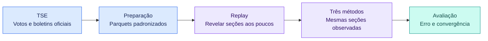
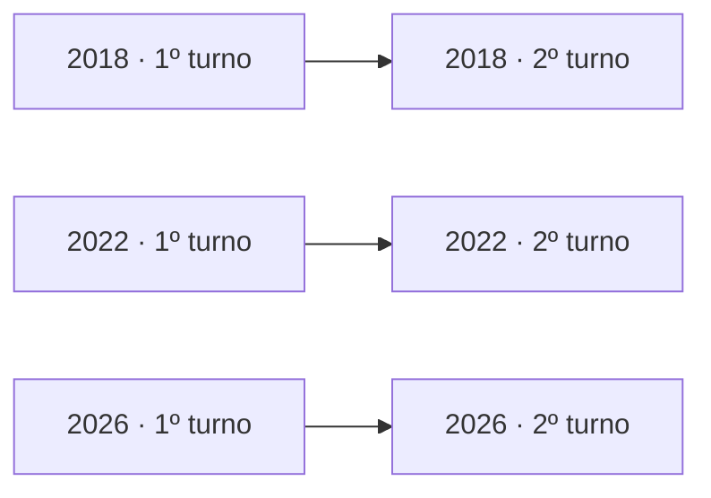
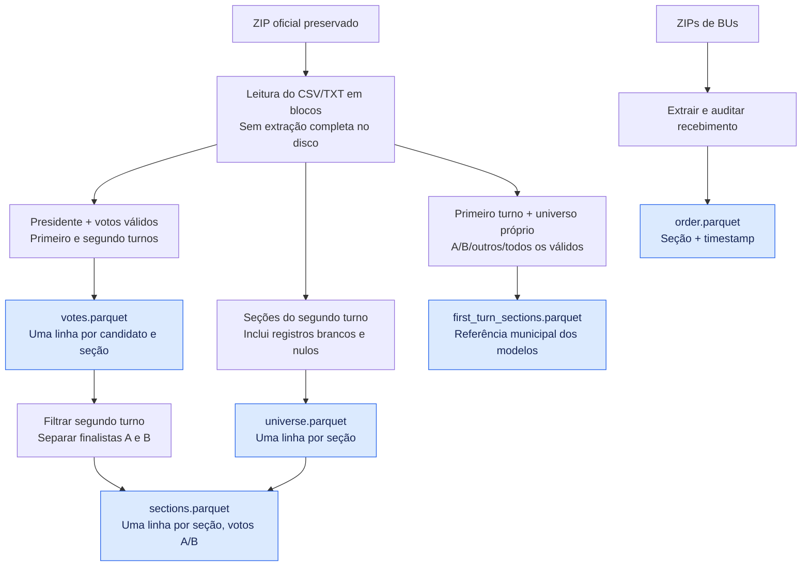
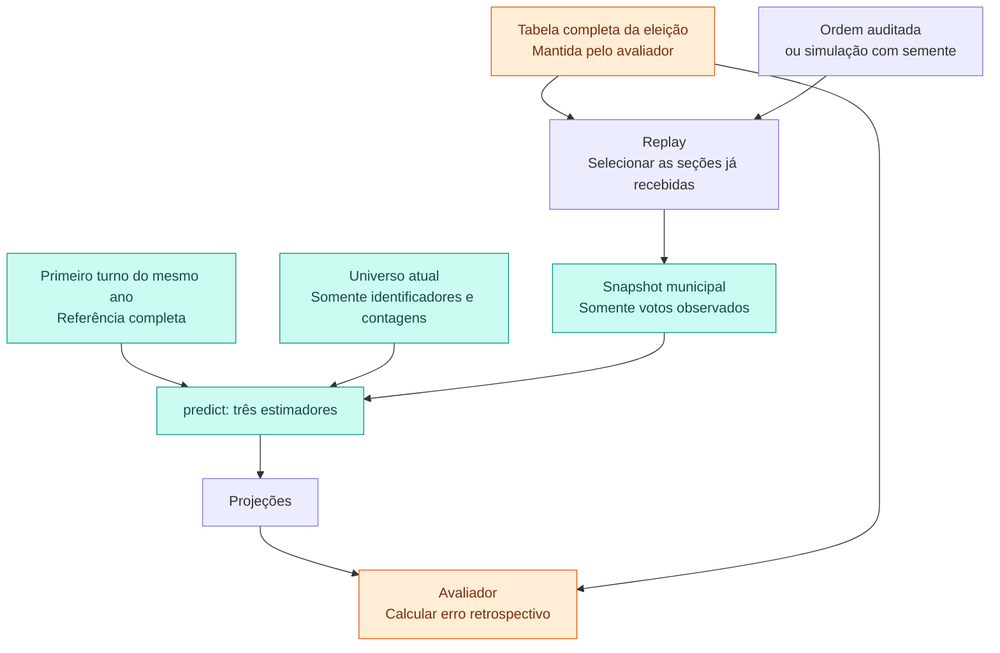
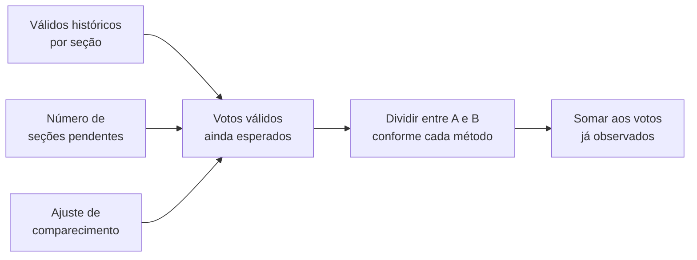
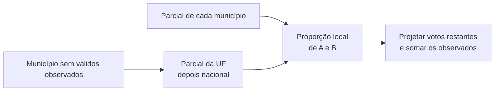
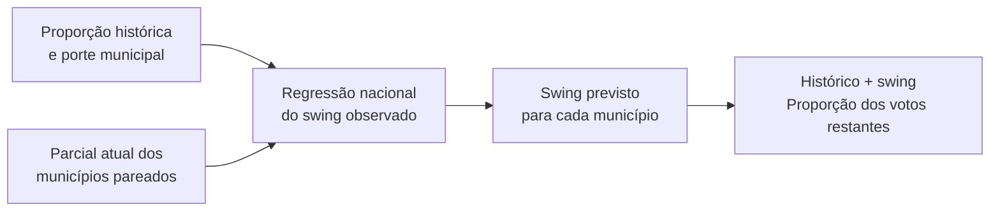
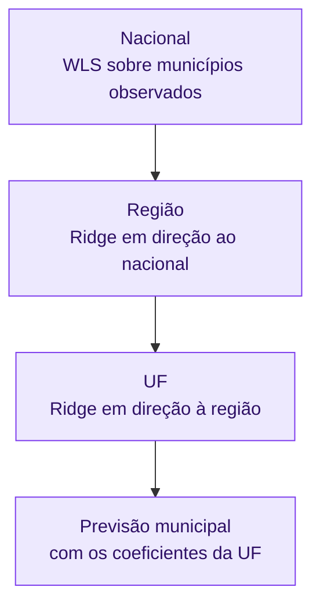
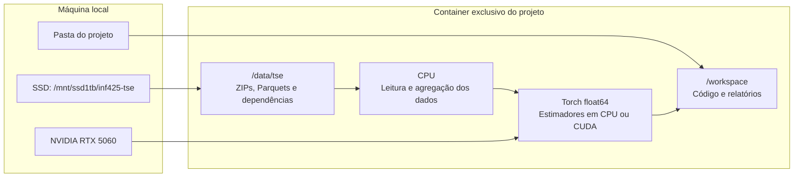

# Projeção eleitoral: do boletim à comparação dos métodos

> **Estado documentado:** 7 de novembro de 2026; recorte vigente em 2018, 2022 e 2026, conforme a [metodologia](metodologia.md).  
> **Pergunta do trabalho:** quanto da apuração precisamos observar para que uma projeção se aproxime do resultado final e permaneça próxima dele?

**Leitura rápida:** [visão geral](#1-visão-geral) · [dados](#2-de-onde-vêm-os-dados) · [métodos](#4-os-três-métodos) · [avaliação](#5-como-comparamos-os-resultados) · [estado atual](#7-o-que-já-está-pronto)  
**Consulta técnica:** [metodologia vigente](metodologia.md) · [guia interativo dos métodos](../reports/metodos.html) · [dicionário dos dados e Parquets](dados.md) · [comandos de execução](../README.md) · [reprodução do experimento](../index.html#reproduzir)

## 1. Visão geral

As primeiras seções recebidas podem representar mais algumas localidades do que outras. A parcial nacional, portanto, pode refletir a **ordem de chegada** dos votos. O projeto compara três formas de usar histórico e geografia para estimar os votos que ainda faltam.

| Conceito | O que significa aqui |
|---|---|
| **Seção** | Unidade cujos votos são revelados em cada atualização. Sua chave inclui UF, município, zona e número da seção. |
| **Município** | Unidade de estimação dos três métodos. Os votos das seções observadas são somados por município. |
| **Histórico** | Resultado do primeiro turno do próprio ano, agregado por município. |
| **Snapshot** | Fotografia da apuração naquele instante, contendo apenas seções já reveladas. |
| **Projeção** | Votos já observados somados à estimativa dos votos restantes. |
| **Parcial simples** | Percentual de um candidato somente entre os votos válidos já observados. É a referência sem correção. |

O estudo avalia **2018, 2022 e 2026**. Cada segundo turno usa exclusivamente o **primeiro turno do mesmo ano** como referência. 2006/2010/2014 ficam somente no acervo. As execuções com referência em eleições anteriores estão descartadas da análise vigente. O escopo executável está em [`configs/study.json`](../configs/study.json).

Cada seta liga os dois turnos do mesmo ano. O primeiro turno completo já está disponível quando começa a apuração do segundo; os votos pendentes do segundo turno permanecem ocultos.

## 2. De onde vêm os dados

O downloader consulta o catálogo oficial do TSE, preserva os ZIPs originais e registra URL, tamanho, data de obtenção e SHA-256. O hash permite identificar exatamente a versão usada.

| Recurso oficial | Para que serve | Entra diretamente nos estimadores? |
|---|---|---|
| Votação presidencial por seção | Votos dos candidatos, histórico e resultado final de comparação. | Apenas histórico e votos atuais já revelados. |
| Votação nominal por município/zona | Conferência independente dos totais por finalista. | Não. |
| Detalhe da apuração por seção | Em 2018, horários de recebimento e de primeira totalização por seção. | Define a ordem da reconstrução, com votos finais. |
| Boletim de urna — BU | Buscar horários de recebimento e reconstruir a sequência das seções. | Apenas define a ordem de chegada. |
| Histórico de totalização | Registro agregado da evolução da totalização. | Não entra no replay atual por seção. |

> **Recebimento e totalização são eventos diferentes.** Em **2022/2026**, o replay usa **recebimento dos BUs**. Em **2018**, usa **primeira totalização parcial por seção**, com votos finais e limitações explícitas. Ela não é apresentada como uma reprodução exata das parciais oficiais publicadas durante a totalização.

### Da origem ao Parquet

**A = finalista do PT; B = outro finalista.** A tabela de correspondência está em [`configs/elections.json`](../configs/elections.json). Esse agrupamento permite comparar o campo eleitoral entre anos, mas B não representa um único partido ao longo de toda a série.

Os Parquets de votação preservam votos válidos dos **dois turnos**. Os estimadores usam o **primeiro turno do próprio ano como referência** e os votos já revelados do segundo turno como observações.

### Tratamentos que mudam a interpretação

| Situação | Tratamento atual |
|---|---|
| Brancos e nulos | Não entram no denominador de votos válidos. As seções continuam no universo quando aparecem na fonte. |
| Seção sem registro na publicação | Não é inventada. A fração apurada usa o universo presente no dataset. |
| Exterior | UF `ZZ`, grupo regional `EX`. |
| UF especial `VT` | Grupo próprio `TRANSIT`, separado do exterior e das cinco regiões. |
| Município sem par histórico | Perfil estadual histórico; se necessário, perfil nacional. |
| Seções agregadas | Identificadores preservados conforme a fonte; não há correspondência de seções entre os turnos. |
| Duplicata de seção/candidato no segundo turno | A preparação falha para exigir resolução da fonte. |

O código do município é o **código eleitoral do TSE**. Ele não deve ser unido diretamente a uma base com código IBGE sem uma tabela de correspondência.

## 3. Como reproduzimos a chegada dos votos

O replay ordena as seções e revela um prefixo da sequência a cada marco. Para os três métodos, esse prefixo é o mesmo.

**A barreira contra vazamento está na interface:** `predict(snapshot, history, config)` não recebe a tabela de votos futuros. O avaliador acessa o resultado completo para medir o erro depois da previsão. Montar o dataset como somente leitura protege os arquivos; a separação de dados e os testes protegem o experimento contra acesso antecipado aos votos.

### Histórico ou simulado?

| Modo | Origem da sequência | Interpretação |
|---|---|---|
| `historical` | Recebimento de BU em 2022/2026; primeira totalização por seção em 2018. | Reconstrução com relógio e limitações identificados. |
| `simulated` | Permutação aleatória com semente, padrão `42`. | Cenário sintético reproduzível. Não é a noite eleitoral real. |

Uma ordem histórica exige cobertura de **100% do universo**, chaves únicas, timestamps válidos e proveniência auditada. Seu checksum deve coincidir com o registrado na auditoria. Se isso falhar, o programa interrompe o replay histórico.

**Empates chegam juntos.** Se o marco pedido é 1%, mas um lote de mesmo horário leva a 1,07%, o snapshot efetivo é 1,07%. Marcos que resultem no mesmo lote geram apenas um snapshot.

## 4. Os três métodos

Os métodos respondem a duas perguntas:

1. Quantos votos válidos ainda devem chegar de cada município?
2. Como esses votos restantes devem se dividir entre A e B?

A primeira resposta é compartilhada. A segunda distingue os estimadores.

### Base comum: estimar o volume restante

Para cada município, o primeiro turno fornece a média de votos válidos por seção, contando todos os candidatos, inclusive os eliminados. A preferência de A é calculada separadamente como A1/(A1+B1), entre os finalistas. O universo próprio do primeiro turno inclui seções com zero válidos. Multiplicamos essa média pelo número de seções ainda pendentes e por um ajuste nacional de comparecimento.

O ajuste compara o volume observado com o volume histórico esperado **nas localidades pareadas que já têm seções observadas**. Uma suavização de 200 mil votos-equivalentes mantém o fator perto de 1 quando há pouca informação.

Equações da base comum

Para o município (i):

| Símbolo | Significado |
|---|---|
| (N_i) | Número de seções atuais no universo. |
| (n_i) | Número de seções já observadas. |
| (h_i) | Votos válidos por seção na referência histórica, com fallback quando necessário. |
| (a_i,b_i) | Votos atuais já observados de A e B. |
| (M) | Municípios pareados com o histórico e com pelo menos uma seção observada. |

O fator nacional é:

$$
r=\frac{\sum_{i\in M}(a_i+b_i)+\lambda_t}
        {\sum_{i\in M}h_i n_i+\lambda_t},
\qquad \lambda_t=200\,000.
$$

O volume restante estimado é:

$$
\widehat R_i=(N_i-n_i)h_i r.
$$

Se o método fornece a proporção prevista (\widehat p_i), então:

$$
\widehat V_A=\sum_i a_i+\sum_i\widehat p_i\widehat R_i,
\qquad
\widehat V_B=\sum_i b_i+\sum_i(1-\widehat p_i)\widehat R_i.
$$

A projeção nacional de A é (\widehat V_A/(\widehat V_A+\widehat V_B)). As proporções municipais previstas são limitadas ao intervalo ([0,1]). Em 100% das seções, (\widehat R_i=0): só restam votos efetivamente observados.

### Método 1 · Pós-estratificação geográfica

**Ideia:** estimar a divisão dos votos de cada município usando sua própria parcial e combinar municípios pelo volume de votos ainda esperado.

Antes de qualquer voto, a referência nacional é a média histórica ponderada. Um município sem votos válidos observados usa a parcial da UF; se a UF também não tiver votos, usa a referência nacional.

**Exemplo ilustrativo, com ajuste de comparecimento igual a 1:**

| Município | Seções totais | Seções observadas | Válidos observados | Votos A observados | Parcial de A | Válidos ainda esperados |
|---|---:|---:|---:|---:|---:|---:|
| X | 10 | 2 | 200 | 120 | 60% | 800 |
| Y | 20 | 2 | 200 | 80 | 40% | 1.800 |

A parcial simples de A é **50%**. A projeção acrescenta `60% × 800 + 40% × 1.800 = 1.200` votos aos 200 já observados: **1.400 de 3.000 votos**, ou **46,67%**. O município maior tem mais votos pendentes a contribuir.

**Limitação:** as primeiras seções de um município também podem ser enviesadas. A ponderação geográfica não elimina esse problema.

### Método 2 · Regressão de swing

**Ideia:** aprender como a votação mudou entre o primeiro e o segundo turno do mesmo ano e extrapolar essa mudança para os votos restantes.

Se um município tinha 60% para A e agora apresenta 65% entre os votos observados, seu swing observado é **+5 pontos percentuais**. A regressão usa essa mudança junto ao perfil histórico e ao porte municipal. Se ela prevê +3 p.p. para outro município cujo histórico era 40%, a proporção prevista nesse local é 43%.

O treinamento inclui apenas municípios com par histórico e votos válidos observados. Sem observações de treinamento, o swing começa em zero. Municípios não pareados recebem características históricas de fallback para a previsão.

Variáveis, pesos e solução da regressão

A variável resposta é:

$$
y_i=\frac{a_i}{a_i+b_i}-p_i^{hist}.
$$

Cada linha de características contém intercepto, proporção histórica padronizada e logaritmo decimal do porte histórico padronizado:

$$
x_i=[1,\ z(p_i^{hist}),\ z(\log_{10}(porte_i^{hist}))].
$$

A média e o desvio usados na padronização dependem do histórico e das contagens estruturais atuais, com pesos (h_iN_i). Não usam votos futuros. Covariável constante recebe escala 1.

O ajuste nacional resolve mínimos quadrados ponderados:

$$
\widehat\beta=\arg\min_\beta
\sum_{i\in treino}(a_i+b_i)(y_i-x_i\beta)^2.
$$

Municípios com mais votos observados têm maior peso. A solução usa pseudoinversa, inclusive quando há poucas observações ou covariáveis sem posto completo. A previsão é (\widehat p_i=\operatorname{clip}(p_i^{hist}+x_i\widehat\beta,0,1)).

### Método 3 · Regressão hierárquica regularizada

**Ideia:** permitir tendências geográficas próprias sem deixar que poucos votos produzam ajustes locais muito instáveis.

As covariáveis são as mesmas do swing. O ajuste nacional é seguido por ajustes regionais e estaduais. Quando um grupo tem poucos votos observados, a penalização o aproxima do nível superior. Sem observações de treinamento no grupo, ele herda os coeficientes do pai.

A implementação atual não ajusta um coeficiente específico por município: a previsão municipal usa suas características e os coeficientes da UF. Exterior e `VT` seguem grupos próprios.

Como a regularização funciona

Cada grupo (g) resolve:

$$
\widehat\beta_g=\arg\min_\beta
\left[\sum_{i\in g\cap treino}w_i(y_i-x_i\beta)^2
+\lambda_g\lVert\beta-\widehat\beta_{pai}\rVert^2\right].
$$

A penalização atua em todos os coeficientes, inclusive o intercepto. A solução usada é:

$$
(X^TWX+\lambda_g I)\widehat\beta_g
=X^TWy+\lambda_g\widehat\beta_{pai}.
$$

| Parâmetro inicial | Valor | Aproximação |
|---|---:|---|
| `lambda_region` | 300.000 | Região → nacional. |
| `lambda_uf` | 150.000 | UF → região. |
| `lambda_turnout` | 200.000 | Ajuste compartilhado de comparecimento → 1. |

Os valores são votos-equivalentes, pois os pesos do ajuste são contagens de votos. São valores iniciais fixos, ainda sem calibração para a comparação científica completa.

### O que muda entre os métodos

| | Pós-estratificação | Swing | Hierárquico |
|---|---|---|---|
| Proporção dos votos restantes | Parcial municipal, com fallback. | Histórico + mudança nacional prevista. | Histórico + mudança prevista por UF, regularizada. |
| Ajuste de regressão | Não. | Um ajuste nacional. | Nacional → região → UF. |
| Volume de votos restantes | Mesmo cálculo compartilhado. | Mesmo cálculo compartilhado. | Mesmo cálculo compartilhado. |
| Risco central | Viés nas primeiras seções locais. | Extrapolação nacional inadequada. | Sensibilidade à força da regularização. |

## 5. Como comparamos os resultados

Os marcos curtos são **1%, 2%, 5%, 10% e 100% das seções do dataset**. A [primeira grade completa em CPU](../index.html#resultados) já avaliou 1% a 100% em passos de 1 p.p., além de 0,1%, 0,2% e 0,5% no início. Os três métodos recebem os mesmos snapshots acumulados; 2% contém as seções do primeiro 1%.

| Medida | Definição | Unidade |
|---|---|---|
| Parcial simples | Votos observados de A ÷ válidos observados. | Fração de 0 a 1. |
| Erro absoluto | `100 × abs(projeção de A − proporção final de A)`. | Pontos percentuais. |
| Convergência sustentada | Primeiro snapshot após o qual todos os erros seguintes ficam dentro do limite. | Fração de seções observadas. |

> **Escalas:** `share_a = 0,52` significa 52%. Já `error_pp = 0,5` significa erro de **0,5 ponto percentual**.

### Entrar na faixa uma vez não basta

Exemplo ilustrativo para limite de 0,5 p.p.:

| Seções observadas | 1% | 2% | 5% | 10% | 100% |
|---|---:|---:|---:|---:|---:|
| Erro | 0,30 | **0,70** | 0,40 | 0,20 | 0,00 |
| Dentro da faixa? | Sim | Não | Sim | Sim | Sim |

A convergência amostrada ocorre em **5%**, pois a estimativa saiu da faixa depois de 1%.

O cálculo usa limites de **1,0; 0,5; 0,25 p.p.** Sem incluir 100% na grade, ele só verifica permanência até o último snapshot executado. Mesmo incluindo 100%, uma grade curta não permite afirmar o que aconteceu entre dois marcos.

As saídas ficam em `projections.parquet`, `projections.csv`, `convergence.json` e `run.json`. O último registra parâmetros, dispositivo, versões, hashes dos dados e dos fontes e, em modo histórico, a proveniência da ordem. O [dicionário técnico](dados.md#5-resultados-projectionsparquet) detalha todas as colunas.

## 6. Onde o projeto roda

A imagem local do TCC é reutilizada pelo ID imutável, sem alterá-la. O ambiente validado usa **Python 3.11.15, Torch 2.12.0.dev20260407+cu128 e CUDA 12.8**. PyArrow e dependências HTTP adicionais ficam no SSD.

| Serviço Compose | Uso | Acesso ao dataset |
|---|---|---|
| `app` | Download, preparação, auditoria e desenvolvimento. | Leitura e escrita. |
| `experiment` | Executar projeções e gravar relatórios no projeto. | Somente leitura. |

A GPU executa os cálculos dos estimadores. Leitura de CSV, preparação em Pandas e organização dos snapshots continuam em CPU. A validação demonstrou equivalência numérica; não foi feito um estudo de ganho de desempenho da GPU.

## 7. O que já está pronto

### Dados e cronologia

| Eleição | Papel | Seções no dataset | Totais por finalista | Ordem por seção utilizável |
|---|---|---:|---|---|
| 2006 | Acervo | 361.406 | Conferidos. | BU não encontrado no catálogo consultado. |
| 2010 | Acervo | 399.962 | Conferidos. | BU não encontrado no catálogo consultado. |
| 2014 | Acervo | 428.852 | Conferidos. | Sem ordem por seção; há 333 parciais nacionais em PDF, fora do replay. |
| 2018 | Avaliação | 454.448 | Conferidos. | Primeira totalização por seção, cobertura integral; oito datas de 2019 preservadas. |
| 2022 | Avaliação | 472.028 | Conferidos. | Sim, cobertura de 100% do universo baixado. |
| 2026 | Avaliação | 499.205 | Conferidos. | Sim, cobertura de 100% do universo baixado. |

A situação acima descreve os recursos já consultados. Ela não prova inexistência de outras séries históricas em outras fontes.

### Validação executada

| Verificação | Resultado registrado |
|---|---|
| Testes automatizados | Suíte registrada em `reports/tests.log`; inclui escopo de três pleitos, exemplos numéricos, PDF e integridade da cronologia. |
| CPU × CUDA sobre snapshot oficial de 2026 | Diferença zero na proporção de A dos três métodos no snapshot validado; referência no primeiro turno de 2026. Manifesto em `reports/runtime.json`. |
| Execuções antigas | Configuração com segundo turno de eleições anteriores descartada; arquivos preservados no acervo local fora do Git. |
| Validações da referência correta | `reports/first-turn-reference-2018`, `-2022` e `-2026`: três métodos, cinco marcos, referência 1º turno → alvo 2º turno do mesmo ano. |
| Primeira grade completa em CPU | 103 snapshots por método/ano, 927 projeções; cerca de 63 s e pico de 878 MiB de RSS, sem CUDA. Resultados em `reports/cpu-study-20261107`. |
| Cronologia de 2018 | Primeira totalização por seção, preservando oito datas de 2019; os votos finais são revelados nesse relógio. |
| Armazenamento medido | Ver inventário atualizado no relatório de validação; novos detalhes e documentos ficam no SSD. |

Essas verificações demonstram funcionamento e consistência. Ainda não demonstram que algum método converge mais cedo ou generaliza melhor.

## 8. Próximos passos do estudo

| Etapa | O que falta investigar |
|---|---|
| Curvas mais densas | Grade de 1% já executada. Avaliar maior resolução com um protocolo igual para os três métodos, respeitando os empates de horário. |
| Calibração histórica | Separar calibração e avaliação, sem acessar o resultado final do segundo turno alvo. A referência dos modelos é o primeiro turno do mesmo ano. |
| Sensibilidade | Medir o efeito das penalizações, pesos, pareamento e hipóteses de comparecimento. |
| Comparação científica | Comparar erro, convergência e estabilidade, separando histórico e simulado. |
| Cobertura temporal | Descrever as diferenças entre os relógios de 2018 e 2022/2026; buscar outros anos apenas se o recorte for ampliado. |

Para rodar o projeto, siga o [README](../README.md). Para consultar campos e abrir os Parquets, use o [dicionário dos dados](dados.md). A [página central](../index.html#reproduzir) reúne o recorte, as fontes e o caminho para repetir os experimentos.

## 9. Visualização das parciais oficiais

O [HTML de apuração](../reports/apuracao.html) permite explorar apenas a votação parcial dos candidatos. Ele funciona sem internet e preserva todas as atualizações de horário distinto presentes nos históricos usados.

| Eleição | Fonte da curva | Atualizações |
|---|---|---:|
| 2018 | Reconstrução com votos finais e horário da primeira totalização por seção. | 1.554 |
| 2022 | Série nacional acumulada do TSE. | 5.286 |
| 2026 | Incrementos por município/zona, somados nacionalmente por horário. | 7.323 |

O eixo horizontal é sempre o **percentual de urnas/seções apuradas** e permanece fixo ao trocar de eleição. A seleção contém somente 2018/2022/2026. Em 2018, a contagem usa as seções do acervo reconstruído. O eixo vertical mostra o percentual de votos válidos de cada candidato. Um controle permite percorrer as atualizações e baixar a série selecionada em CSV.

**As duas sequências têm usos diferentes:** o replay usa recebimento em 2022/2026 e primeira totalização em 2018. O HTML distingue os históricos oficiais agregados da reconstrução por seção. Na série de 2026, o último registro contém 499.205 de 499.248 seções previstas, ou aproximadamente 99,9914%. Os votos finais dos candidatos coincidem com os resultados auditados. A página preserva esse denominador e não estende a série artificialmente a 100%.

As curvas também estão em [`reports/apuracao/curves.parquet`](../reports/apuracao/curves.parquet). O [dicionário](dados.md#9-curvas-oficiais-curvesparquet) descreve seu esquema. O comando para regenerar a página está no [README](../README.md#6-regenerar-as-páginas).

A pesquisa de cronologia e a minuta de solicitação ao TSE ficam preservadas no acervo local fora do Git como registro da investigação. As lacunas territoriais de 2010/2014 não bloqueiam a metodologia vigente. As 333 parciais nacionais de 2014 e os pontos documentais de 2010 continuam no SSD, fora do HTML e da avaliação atual.

## 10. Guia interativo dos estimadores

O [caderno de métodos em HTML](../reports/metodos.html) reúne três exemplos fictícios: ritmos diferentes de chegada em duas cidades, mudança eleitoral nacional e regularização de um estado com poucos votos. Os controles permitem explorar ausência de observações, avanço local, intensidade da mudança e penalização. Fórmulas e limites estão em blocos expansíveis.

Os 858 estados são calculados pela mesma API `predict` dos experimentos e preservados em `reports/metodos/examples.json`. O navegador apenas apresenta os resultados pré-calculados. Os exemplos isolam mecanismos, com 100 válidos por seção e fator de comparecimento igual a 1; não são uma comparação empírica dos três métodos. A hierarquia usa penalizações didáticas menores, identificadas na página, sem alterar os padrões dos experimentos.

## 11. Projeções, convergência e estabilidade dos experimentos

O [painel dos resultados](../reports/convergencia.html) usa a grade CPU dos três pleitos, com primeiro turno do mesmo ano como referência. Mostra três curvas de projeção e a linha do resultado final por ano. A inspeção permite percorrer os 103 snapshots, ampliar os primeiros 10%, incluir a parcial simples e alternar entre projeção, erro absoluto e variação entre snapshots consecutivos.

A estabilidade é descrita pela mudança absoluta da projeção em pontos percentuais. O passo efetivo de apuração é exibido; a variação não é normalizada pelo intervalo nem representa incerteza. Os pontos de convergência sustentada estão disponíveis para os limites de 1,0/0,5/0,25 p.p., respeitando a grade calculada.

A tabela traz os marcos de **1%, 2%, 5% e 10%**: estimativas dos dois finalistas, resultado final real, erro absoluto e avanço efetivo. Empates de horário podem ultrapassar um marco; não há interpolação ou substituição por um marco solicitado mais tarde. São 36 registros em CSV/Parquet. O HTML é independente e exporta CSV e SVG com legendas, candidatos e unidades; figuras Matplotlib dos três anos também estão disponíveis em PNG/SVG.

O exportador apenas lê as 927 projeções já calculadas. A validação conferiu os marcos diretamente contra os arquivos originais, a igualdade dos snapshots, os hashes e as exportações. Consulte o [dicionário do painel](dados.md#12-painel-dos-experimentos-reportsconvergencia) e o comando no [README](../README.md#6-regenerar-as-páginas).

## 12. Parcial e projeção com faixa sombreada

O [painel com faixas](../reports/projecoes.html) mostra 2018/2022/2026, com seleção dos três estimadores. Cada candidato tem uma cor: linhas tracejadas mostram sua parcial, linhas sólidas mostram sua projeção e áreas transparentes mostram os quantis 5–95% das réplicas. Cursor, reprodução, marcos e exportação SVG/CSV usam sempre percentual de seções. A projeção pontual original é preservada. Em 2018 aparecem Haddad/Bolsonaro e a reconstrução com votos finais na primeira totalização por seção, incluindo registros tardios de 2019; o painel distingue esse relógio do recebimento de BUs em 2022/2026.

A tooltip das projeções mostra o candidato, modelo/ano, projeção, parcial e faixa experimental no snapshot calculado mais próximo, com percentual efetivo de seções. A cor acompanha o candidato e a posição se ajusta às bordas da tela. Hover, toque e navegação pelo teclado usam os mesmos dados; não são calculadas novas estimativas entre snapshots.

As faixas vêm de 200 refits por snapshot, com pesos exponenciais normalizados nas seções observadas de cada município. Os votos conhecidos ficam fixos no total; só as estimativas pendentes variam. O resultado final entra depois, na avaliação de cobertura, e o bootstrap não recebe votos pendentes.

**Estado experimental:** a cobertura do final foi baixa. Esse bootstrap condicional não cobre o viés da ordem de chegada e a incerteza específica de localidades sem observações. O painel exibe a contagem correspondente ao modelo selecionado; os quantis não são apresentados como margem calibrada de acerto eleitoral. Os esquemas estão no [dicionário](dados.md#13-faixas-de-reamostragem-reportsprojecoes).
