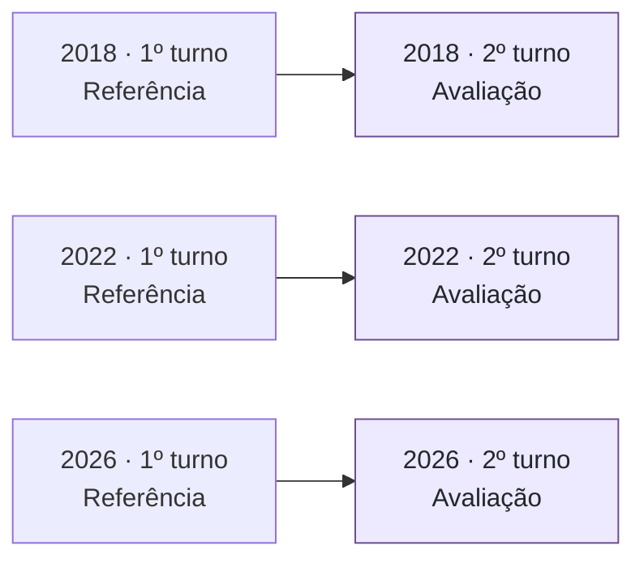
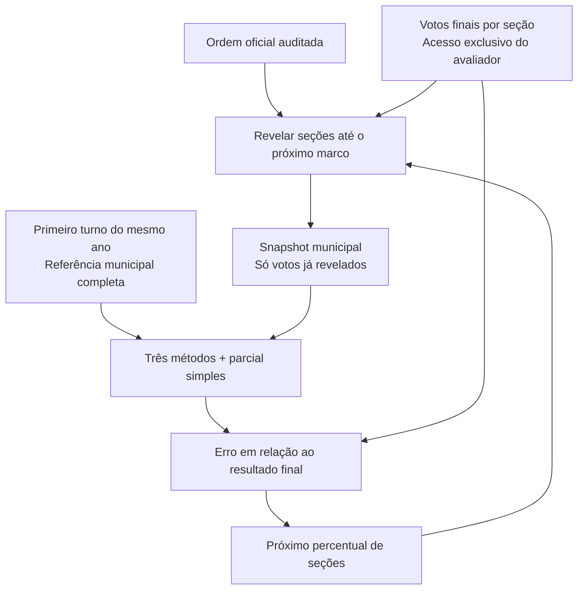
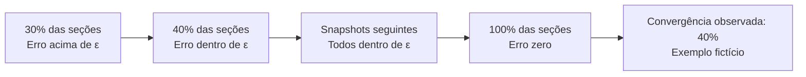

# Metodologia: convergência por percentual de urnas

Versão 3 · 7 de novembro de 2026. Esta é a metodologia vigente. Define a investigação do segundo turno com referência exclusivamente no primeiro turno do mesmo ano. Substitui a configuração incorreta que utilizava o segundo turno de eleições anteriores. Os PDFs originais são documentos de origem, não a especificação vigente.

**Pergunta:** qual percentual das seções precisamos observar para que a projeção se aproxime do resultado final e permaneça próxima dele?

O estudo compara pós-estratificação, regressão de swing e regressão hierárquica regularizada nos **segundos turnos presidenciais de 2018, 2022 e 2026**. A parcial simples dos votos observados serve de referência. O [guia interativo](../reports/metodos.html) explica os três métodos com exemplos fictícios; a [especificação](especificacao.md#4-os-três-métodos) detalha suas equações.

## 1. Recorte e histórico

| Pleito avaliado | Referência municipal | Ordem do replay |
|---|---|---|
| 2018 | Primeiro turno de 2018 | Primeira totalização parcial registrada por seção, no detalhe oficial. |
| 2022 | Primeiro turno de 2022 | Recebimento de BUs. |
| 2026 | Primeiro turno de 2026 | Recebimento de BUs. |



Os três anos têm ordem por seção auditada com cobertura integral do universo baixado, permitindo testar os modelos com o mesmo avanço da apuração. 2006, 2010 e 2014 ficam somente no acervo e não alimentam os estimadores. Execuções que usaram eleições anteriores como referência estão identificadas como descartadas no [índice de resultados antigos](../reports/legacy-methodology.md). A indisponibilidade de cronologia territorial de 2010/2014 deixa de bloquear este recorte.

O escopo executável está em [`configs/study.json`](../configs/study.json); as referências e os finalistas estão em [`configs/elections.json`](../configs/elections.json). CLI e API de experimentos recusam anos fora de 2018/2022/2026. Download e preparação continuam permitindo os anos do acervo, inclusive 2014.

## 2. Unidade de avanço

O eixo X é sempre o **percentual de urnas/seções reveladas no universo do dataset**:

$$
f_t = 100\frac{\text{seções reveladas até o snapshot }t}{\text{total de seções no dataset do pleito}}.
$$

Cada seção conta uma vez, independentemente da quantidade de votos. Seções com zero votos válidos continuam no denominador quando presentes na publicação. “Urnas” é o termo de apresentação; o identificador operacional é a chave de seção `uf, municipality, zone, section`. Seções ausentes da publicação não são inventadas. Horário identifica a ordem e os empates; não é o eixo de convergência.

Recomendamos uma grade de **1% a 100%, em passos de 1 ponto percentual**. Seções com o mesmo timestamp chegam juntas. Assim, a fração efetiva pode superar o marco pedido, e vários marcos podem corresponder ao mesmo snapshot; o avaliador remove repetições. As comparações usam a fração efetiva registrada, sem interpolação.

## 3. Replay e proteção contra informação futura



Os métodos recebem o mesmo snapshot municipal do segundo turno, primeiro turno completo do mesmo ano e universo estrutural atual, sem votos das seções pendentes. O resultado completo fica no avaliador, que calcula o erro depois da previsão. O denominador estrutural atual e as contagens de seções são conhecidos; votos futuros não entram nas covariáveis, no ajuste de comparecimento ou no treinamento.

A corresponde ao finalista do PT; B, ao outro finalista. A convenção é explícita e não pressupõe que B represente o mesmo partido entre anos. O histórico é agregado por código eleitoral municipal; municípios sem par recebem fallback estadual e, se necessário, nacional. Não há pareamento de seções entre eleições ou harmonização territorial adicional.

## 4. Estimadores e parâmetros

| Método | Preferência estimada nos votos pendentes |
|---|---|
| Pós-estratificação | Parcial municipal; sem válidos locais, parcial da UF, depois nacional e histórico antes do primeiro voto. |
| Swing | Histórico municipal + mudança aprendida por WLS nacional, com intercepto, proporção histórica e log do porte histórico. |
| Hierárquico | Mesmo WLS nacional, seguido de Ridge dos coeficientes região → nacional e UF → região. |

No município m, a preferência de referência é **pₘ = A₁ₘ / (A₁ₘ + B₁ₘ)**, com os mesmos dois finalistas do segundo turno. Os votos dos eliminados não entram nesse denominador. Essa é uma covariável, não uma previsão de transferência dos votos dos eliminados; o swing é aprendido a partir das parciais do segundo turno.

O porte histórico e a média de válidos por seção usam **todos os votos válidos presidenciais do primeiro turno**, inclusive de candidatos eliminados. O denominador de seções vem do universo próprio do primeiro turno, incluindo seções com zero válidos. Sem votos dos finalistas no município, a preferência recebe fallback estadual/nacional; o volume local conhecido é preservado, inclusive quando é zero. O volume só recebe fallback quando o município está ausente da referência.

Todos estimam o volume pendente com seções restantes do segundo turno × média de válidos por seção do primeiro turno × fator nacional de comparecimento. Somam os votos observados sem alterá-los. A parcial simples é a proporção de A entre os válidos revelados no mesmo snapshot.

Os parâmetros iniciais são fixos: λ região = 300.000, λ UF = 150.000 e λ comparecimento = 200.000 votos-equivalentes. A CLI usa esses padrões; a API aceita `Config`. As covariáveis são padronizadas com informação histórica e estrutural. Os valores não foram calibrados e não devem ser escolhidos usando o resultado futuro do próprio pleito. Eventual calibração deve ser separada da avaliação e registrar protocolo e parâmetros, sem consultar o resultado final ou os votos ocultos do segundo turno alvo. A fonte da referência continua sendo exclusivamente o primeiro turno do próprio ano.

## 5. Erro e convergência sustentada

Para cada método e snapshot:

$$
e_t=100\left|\widehat p_{A,t}-p_A^{final}\right|.
$$

O erro é medido em **pontos percentuais**, usando apenas válidos dos dois finalistas. No segundo turno, o erro absoluto de B é igual ao de A. A parcial simples recebe a mesma métrica; fica nula quando não há válidos observados.

Para cada limite **ε ∈ {1,0; 0,5; 0,25} p.p.**, a convergência sustentada é o primeiro snapshot da grade a partir do qual todos os erros seguintes permanecem ≤ ε, incluindo o ponto de 100%.



Entrar na faixa e sair depois não conta como convergência sustentada. A conclusão vale apenas na resolução dos snapshots calculados, sem garantir o comportamento entre eles. Se a grade não inclui 100%, não se deve descrevê-la como convergência até o fim. O endpoint dos modelos deve reproduzir os totais auditados, porque não restam votos a estimar. Esse acerto no endpoint é uma checagem, não evidência de antecipação útil.

A análise principal deve apresentar curvas de erro versus percentual efetivo por ano, linhas da parcial simples e os três limiares; depois, uma tabela de convergência por método/ano/limiar. Três pleitos permitem comparação descritiva, sem sustentar generalização ampla ou superioridade antes dos experimentos completos.

## 6. O que a cronologia permite afirmar

- **2018:** os votos finais são revelados na primeira totalização registrada por seção. Não são recuperadas correções intermediárias ou o instante exato de publicação das parciais nacionais. Oito seções com data de 25/02/2019, somando 1.712 válidos, continuam no replay e no endpoint; não são cortadas para encerrar a curva na noite eleitoral.
- **2022/2026:** o replay usa recebimento de BUs. Recebimento não equivale a totalização nem a publicação ao público. Os resultados finais por seção não recompõem versões intermediárias dos votos.
- **Mesma escala, relógios diferentes:** comparar por percentual remove a duração da noite do eixo X, mas não elimina diferenças entre esses processos. Relate os resultados por pleito e explicite essa limitação.
- **Ordens simuladas:** servem para diagnóstico e sensibilidade, identificadas com modo e semente. Não substituem a comparação principal com ordem registrada.

O [HTML de apuração](../reports/apuracao.html) também exibe apenas os três anos e mantém o eixo percentual. Em 2018, ele usa a reconstrução por primeira totalização. Em 2022/2026, exibe históricos oficiais agregados de totalização, diferentes da ordem de recebimento usada no replay. Esses históricos preservam o denominador oficial de seções, que pode diferir do universo baixado; o último ponto publicado não é estendido artificialmente a 100%.

## 7. Reprodução e artefatos

```bash
# Preparar somente as referências dos três primeiros turnos já baixados.
./scripts/container.sh exec -T app /opt/venv/bin/python -m projecao prepare-reference

# Troque o ano por 2018, 2022 ou 2026 e escolha uma saída nova.
./scripts/container.sh run --rm experiment experiment --year 2018 --device cuda \
  --mode historical --grid-step .01 --output reports/estudo-v3-2018

# Regenerar as páginas independentes e seus manifestos.
./scripts/container.sh exec -T app /opt/venv/bin/python scripts/build_apuracao.py
./scripts/container.sh exec -T app /opt/venv/bin/python scripts/build_metodos.py
```

Cada nova execução registra a configuração `study`, ano, turno alvo (2), turno da referência (1), proveniência, parâmetros, modo, semente, dispositivo, versões e hashes em `run.json`. `projections.parquet`/CSV contêm projeções, parcial simples, frações efetivas, erros e tempos. `convergence.json` contém os limiares e resultados na grade amostrada. As pastas antigas não são reescritas e não passam a representar esta metodologia por mudança de documentação.

As validações em `reports/first-turn-reference-<ano>` usam 1%, 2%, 5%, 10% e 100%, com referência no primeiro turno e ordem histórica do segundo turno. Resultados das configurações anteriores não integram esta metodologia.

A [primeira análise em CPU](../reports/cpu-study-20261107/analysis.md) já executou os três pleitos com parâmetros fixos: 0,1%, 0,2%, 0,5% e depois 1% a 100%, passo de 1 p.p. São 103 snapshots por método e ano, 927 projeções, mais a parcial simples nos mesmos snapshots. O relatório contém erros, convergência nos três limiares, gráficos e registros de recursos. É uma comparação descritiva inicial; calibração e análises de sensibilidade permanecem separadas. Consulte também o [inventário medido](../reports/validation.md) e o [dicionário dos Parquets](dados.md).

## 8. Faixas experimentais de reamostragem

O [gráfico de parcial e projeção](../reports/projecoes.html), com 2018/2022/2026, acrescenta uma faixa aos estimadores existentes. Não altera as projeções pontuais, o primeiro turno de referência nem as métricas de convergência. A faixa difere da tolerância em torno do resultado final no painel de convergência: ela é calculada sem conhecer esse resultado. A fonte temporal de 2018 continua sendo a reconstrução com votos finais na primeira totalização por seção; 2022/2026 usam recebimento de BUs.

Para cada snapshot, 200 réplicas recebem pesos exponenciais por seção observada, normalizados dentro de cada município. O número de seções recebido por município fica fixo. Reajustam-se os mesmos modelos com os totais reponderados; os votos pendentes estimados variam, e os votos efetivamente observados são somados como constantes. Os quantis 5% e 95% formam intervalos pontuais condicionais; em 100% não restam votos pendentes.

A [base estatística](https://ngreifer.github.io/fwb/reference/fwb.html) é o bootstrap ponderado; a estratificação municipal e a separação entre ajuste e votos conhecidos são escolhas desta implementação. Não se trata de uma reprodução do modelo de incerteza do Mattecca.

**A cobertura eleitoral não está calibrada e foi baixa na avaliação retrospectiva.** As seções observadas não são uma amostra aleatória da eleição; a reamostragem não representa o erro sistemático dessa seleção nem perfis inteiramente ausentes. Municípios com uma única seção observada têm distribuição empírica local degenerada. Não se interpreta a massa de 90% entre quantis como 90% de chance de conter o resultado real, nem os intervalos como banda simultânea ou probabilidade de vitória. A cobertura retrospectiva por ano/método fica registrada sem alterar os limites; os snapshots dependentes não equivalem a eleições independentes.
