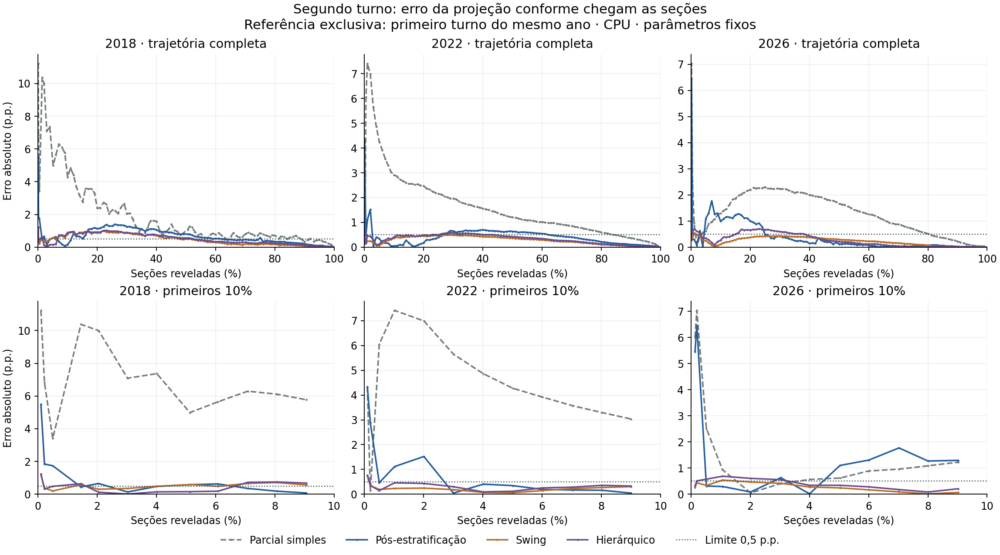

# Testes em CPU: convergência dos três métodos

**Referência:** primeiro turno do mesmo ano. **Alvos:** segundos turnos de 2018, 2022 e 2026. Ordem histórica auditada: primeira totalização por seção em 2018; recebimento de BUs em 2022/2026.

## Viabilidade com a GPU ocupada

O piloto de 2022 foi executado em CPU e a grade completa também. O container não recebeu dispositivos NVIDIA e CUDA não foi inicializado. Limites efetivos: 2 CPUs, 2 GiB de RAM, zero swap adicional e prioridade nice 10. O dataset foi montado somente para leitura. A imagem CUDA existente foi reutilizada, sem reconstrução.

A grade dos três anos levou 63,13 segundos, excluindo a inicialização do container e do Python. Pico de RSS do processo: 877,5 MiB. Esses números são desta execução, com outro treinamento em andamento; não constituem benchmark CPU versus GPU.

As opções de limite seguem a [documentação do Docker](https://docs.docker.com/engine/containers/resource_constraints/). Também foi definido `CUDA_VISIBLE_DEVICES=-1`, conforme a [documentação do PyTorch](https://docs.pytorch.org/docs/2.15/cuda_environment_variables.html), além da ausência dos dispositivos no container.

## Protocolo utilizado

1. Ordenar as seções pelo relógio registrado. Revelar prefixos acumulados: 2% inclui o primeiro 1%. Empates de horário entram juntos.
2. Executar os três métodos sobre exatamente as mesmas seções, mantendo ocultos os demais votos do segundo turno.
3. Comparar projeção e parcial simples com o resultado final, em pontos percentuais. A parcial simples é o controle sem correção.
4. Usar 0,1%, 0,2%, 0,5% e depois 1% a 100%, passo de 1 ponto percentual. Registrar o percentual efetivo quando um empate supera o marco.
5. Medir convergência sustentada: primeiro snapshot após o qual todos os erros seguintes ficam ≤ 1,0, 0,5 ou 0,25 p.p., até 100%. Não basta entrar na faixa uma vez.
6. Manter parâmetros fixos, sem escolher penalizações olhando o resultado final do próprio pleito. Não foram feitos ajustes para favorecer um método.

Em 100%, os métodos apenas somam votos já conhecidos e devem reproduzir o resultado final. Isso é uma checagem, não sinal de antecipação útil. As conexões entre pontos nas figuras são visuais; as métricas só afirmam comportamento nos snapshots calculados.

## O que acontece no primeiro 1%

A é Haddad em 2018 e Lula em 2022/2026. Os percentuais abaixo são dos votos válidos projetados para A. O percentual de seções pode exceder 1% por causa de empates.

| Ano | Método | Seções efetivas (%) | A estimado (%) | A final (%) | Erro (p.p.) |
|---|---|---:|---:|---:|---:|
| 2018 | Parcial simples | 1,4532 | 34,49 | 44,87 | 10,38 |
| 2018 | Pós-estratificação | 1,4532 | 45,32 | 44,87 | 0,45 |
| 2018 | Swing | 1,4532 | 45,45 | 44,87 | 0,58 |
| 2018 | Hierárquico | 1,4532 | 45,51 | 44,87 | 0,64 |
| 2022 | Parcial simples | 1,0184 | 43,49 | 50,90 | 7,41 |
| 2022 | Pós-estratificação | 1,0184 | 52,02 | 50,90 | 1,12 |
| 2022 | Swing | 1,0184 | 51,14 | 50,90 | 0,23 |
| 2022 | Hierárquico | 1,0184 | 51,36 | 50,90 | 0,46 |
| 2026 | Parcial simples | 1,0691 | 52,72 | 51,79 | 0,94 |
| 2026 | Pós-estratificação | 1,0691 | 51,49 | 51,79 | 0,30 |
| 2026 | Swing | 1,0691 | 52,33 | 51,79 | 0,54 |
| 2026 | Hierárquico | 1,0691 | 52,48 | 51,79 | 0,69 |

## Convergência sustentada: limite de 0,5 p.p.

Percentual efetivo de seções a partir do qual o erro permanece na faixa em toda a grade restante. Os outros limiares estão em `convergence-comparison.csv`.

| Ano | Parcial simples | Pós-estratificação | Swing | Hierárquico |
|---|---:|---:|---:|---:|
| 2018 | 93,05% | 76,02% | 52,02% | 53,00% |
| 2022 | 85,00% | 63,01% | 30,02% | 44,01% |
| 2026 | 81,04% | 25,04% | 2,02% | 39,01% |

Em 2018, a pós-estratificação já tinha erro de 0,45 p.p. no marco inicial, mas voltou a sair da faixa: sua convergência sustentada foi em 76,02% das seções. O swing, inicialmente menos preciso nesse marco, permaneceu dentro da faixa a partir de 52,02%. Comparar somente o primeiro 1% inverteria essa leitura.

Nesta configuração de parâmetros, o swing nacional atingiu convergência sustentada de 0,5 p.p. antes dos outros dois projetores nos três pleitos. A versão hierárquica não foi automaticamente melhor. Isso descreve estes dados e estes parâmetros, sem demonstrar superioridade universal ou identificar a causa da diferença.

## Interpretação e próximos cuidados

A proposta de testar o primeiro 1% é adequada como início. A comparação útil exige seguir a trajetória inteira, pois um método pode acertar cedo e se afastar depois. O critério sustentado resolve isso na resolução da grade. Os limites foram fixados antes de ler estes resultados.

Os três pleitos são estudos de caso, com relógios de chegada diferentes. Os resultados não demonstram superioridade universal nem intervalos de confiança. Não use reamostragem aleatória de seções como substituto da sequência registrada; ela altera o viés que estamos investigando. Ordens aleatórias podem ser um experimento complementar identificado separadamente.

Para uma comparação isolada do desempenho computacional, CPU e GPU precisam ser medidas posteriormente em condições controladas, sem o treinamento concorrente. Para testar a qualidade das projeções agora, CPU é suficiente.

## Arquivos e verificações

- `grid-<ano>/`: projeções, convergência, metadados e hashes da execução real.
- `at-one-percent.csv`: estimativas e erros do primeiro 1%.
- `convergence-comparison.csv`: os três limiares, incluindo a parcial simples.
- `comparison.parquet`: curvas dos três métodos e da parcial simples. Nas linhas `baseline`, votos A/B são apenas observados; ajuste de comparecimento e tempo do modelo ficam ausentes.
- `grid-resources.json`: limites efetivos, tempos, pico de RAM e confirmação de ausência de CUDA.
- `error-curves.png` e `.svg`: gráficos exportáveis.
- Todos os métodos foram conferidos sobre os mesmos snapshots; os nove endpoints dos modelos reproduzem os resultados finais.
