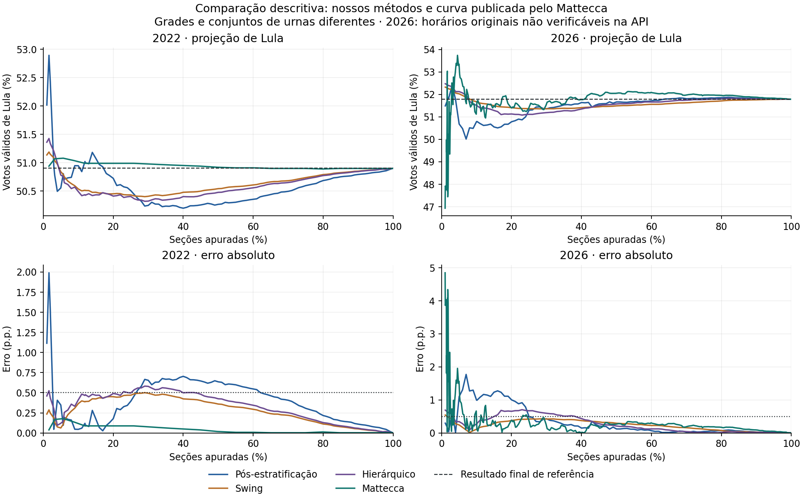

# Comparação com Mattecca: segundo turno de 2022 e 2026

**Natureza:** comparação descritiva de curvas publicadas e replays. Não é uma avaliação dos quatro modelos sobre os mesmos votos observados.

## Fontes e alinhamento

- Mattecca 2022: backtest presidencial, caso `2022-2`, modo por seção, da [API pública de backtests](https://apuracao.mattecca.com.br/api/backtests_cliente). Não é uma projeção que presumimos ter sido publicada em 2022.
- Mattecca 2026: série presidencial disponível na [API pública do painel](https://apuracao.mattecca.com.br/api/estado/presidente). Foram preservados os percentuais, projeções e horários exatamente como consultados.
- Nossos métodos: replays com recebimento de BUs, referência no primeiro turno do mesmo ano, parâmetros fixos. Os arquivos originais da grade CPU foram preservados.
- Para cada marco nominal de 1%, 2%, 5% e 10%, escolhemos o primeiro registro do Mattecca que atinge o marco. Recalculamos nossos três métodos em CPU naquele percentual. Empates dos nossos timestamps podem ultrapassá-lo um pouco; ambos os avanços aparecem na tabela.
- O erro é calculado para Lula, em pontos percentuais, usando um resultado final comum: o resultado validado no nosso dataset. Isso evita comparar erros contra finais de referência diferentes.

Referências finais de Lula: **2022 = 50,902405%**; **2026 = 51,785183%**. Não usamos a última parcial bruta do Mattecca como verdade final.

## Erro nos marcos publicados e alinhados

Valores em pontos percentuais. As linhas identificam os marcos pedidos; a porcentagem efetivamente disponível pode ser maior. As projeções de Lula e os valores sem arredondamento estão em `comparison.csv`.

| Ano | Marco nominal | Seções Mattecca (%) | Seções nossas (%) | Pós-estratificação | Swing | Hierárquico | Mattecca |
|---|---:|---:|---:|---:|---:|---:|---:|
| 2022 | 1% | 1,62 | 1,6296 | 1,99 | 0,29 | 0,52 | 0,04 |
| 2022 | 2% | 3,26 | 3,2646 | 0,12 | 0,13 | 0,25 | 0,17 |
| 2022 | 5% | 5,71 | 5,7113 | 0,09 | 0,11 | 0,14 | 0,18 |
| 2022 | 10% | 11,89 | 11,9126 | 0,12 | 0,39 | 0,47 | 0,09 |
| 2026 | 1% | 1,02 | 1,0691 | 0,30 | 0,54 | 0,69 | 4,85 |
| 2026 | 2% | 2,03 | 2,0356 | 0,04 | 0,47 | 0,61 | 1,55 |
| 2026 | 5% | 5,00 | 5,0350 | 1,10 | 0,24 | 0,34 | 1,56 |
| 2026 | 10% | 10,11 | 10,1189 | 0,99 | 0,12 | 0,28 | 0,11 |

## Convergência sustentada até erro de 0,5 p.p.

Primeiro ponto após o qual todos os pontos posteriores da própria série ficam dentro do limite. Cada fonte tem sua grade; não há garantia entre os pontos. Mantivemos os registros repetidos de percentual do Mattecca, inclusive atualizações depois de atingir 100%. Nossas curvas usam a grade original acrescida dos quatro pontos alinhados.

| Ano | Pós-estratificação | Swing | Hierárquico | Curva Mattecca consultada |
|---|---:|---:|---:|---:|
| 2022 | 63,01% | 30,02% | 44,01% | 1,62% |
| 2026 | 25,04% | 2,02% | 39,01% | 24,86% |

## Limitação decisiva da série de 2026

A resposta consultada contém 375 registros. **371 trazem o mesmo horário: 26/10/2026 09:05:23**, na manhã seguinte à eleição. A lista está ordenada por percentual, mas esses campos não comprovam os horários originais de publicação. Não é possível afirmar, apenas com essa API, que cada projeção corresponde ao que foi exibido ao vivo naquele percentual.

Além disso, a última parcial bruta da API é Lula 51,725%, enquanto o final de referência do nosso dataset é 51,785183%. A última projeção deles é 51,784%. Isso reforça que as bases não são idênticas; parcial bruta e projeção não foram confundidas com o resultado final.

Os números de 2026 apresentados neste relatório descrevem a curva atualmente disponibilizada. Não constituem comprovação de desempenho operacional ao vivo nem justificam uma afirmação geral de superioridade.

## Leitura dos resultados

- Em 2022, o Mattecca tem erro menor no primeiro e no último dos quatro pontos comparados. Nossos métodos têm erros menores em parte dos pontos intermediários. Na permanência abaixo de 0,5 p.p., a curva publicada pelo Mattecca entra muito antes das nossas curvas.
- Em 2026, nossos métodos têm erros menores nos três primeiros pontos dessa série consultada. Perto de 10%, o nosso swing e o Mattecca ficam próximos, com vantagem numérica pequena para o Mattecca. A anomalia dos horários impede transformar essa observação em uma conclusão sobre a noite ao vivo.
- As diferenças não isolam o efeito do estimador: nossos snapshots seguem recebimento de BUs; o site usa seus dados de totalização e disponibilidade de boletins, com modos por seção/município. Porcentagem de urnas próxima não significa que sejam as mesmas urnas.
- As densidades das grades também diferem. A variação entre pontos não foi usada para ranquear estabilidade entre fontes com frequências distintas. Nossos modelos não produzem os intervalos de incerteza publicados por eles.
- Uma comparação experimental controlada exige executar ambos os modelos sobre exatamente os mesmos snapshots, com o mesmo resultado final e protocolo de calibração. Esta comparação pública não fornece isso.

## Arquivos preservados

Este complemento mantém `comparison.md`, `comparison.csv` e `comparison.png`. As respostas originais da API, scripts e replays alinhados foram arquivados localmente fora do Git na redução do projeto; também permanecem no commit inicial. A reprodução principal dos três métodos está descrita no [README](../../README.md). Este subconjunto preserva a comparação já realizada, sem fornecer sua reprodução independente completa.
